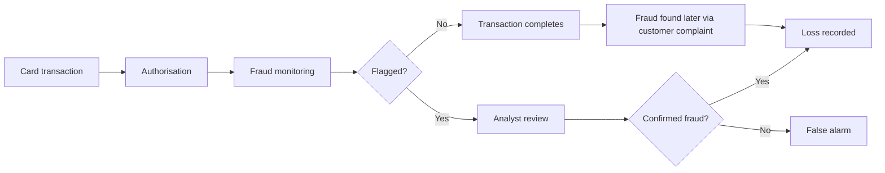
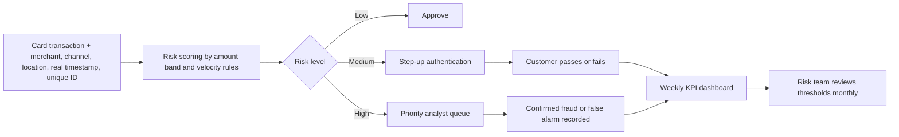

# 03. Process Flow: As-Is vs To-Be

## As-Is (what limits the analysis today)

**Pain points**
1. Fraud is only about 1 in 600 transactions, so volume reports hide it.
2. The data has no merchant, customer, channel or real timestamp, so risk cannot be explained by who, where or when.
3. Features V1-V28 are anonymised, so statistical signals cannot be turned into rules a business person can read.
4. Accuracy looks great (99.83%) even when no fraud is caught.

## To-Be (proposed monitoring process)

| As-Is | To-Be | Recommendation |
|---|---|---|
| Review by volume | Risk-ranked queue for large amounts | 1 |
| Block or approve only | Step-up authentication in the middle range | 2 |
| Small frauds handled manually | Automated velocity rules for tiny repeated amounts (1.00 is 22% of fraud cases) | 3 |
| No time-window monitoring | Stricter monitoring in low-traffic windows (fraud rate 0.83% vs 0.14%), using real timestamps | 4 |
| Anonymised signals only | Rules tested on real business attributes | 5 |
| Ad hoc reporting | Weekly KPI dashboard | 6 |
| Missing fields | Capture merchant, location, channel, timestamp, ID | 7 |
