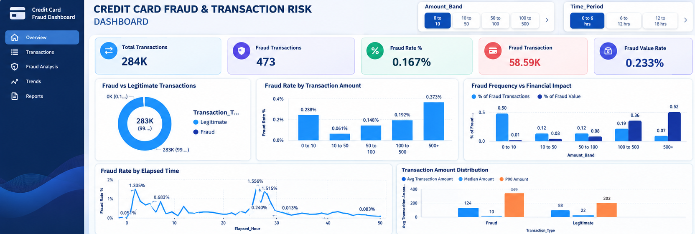
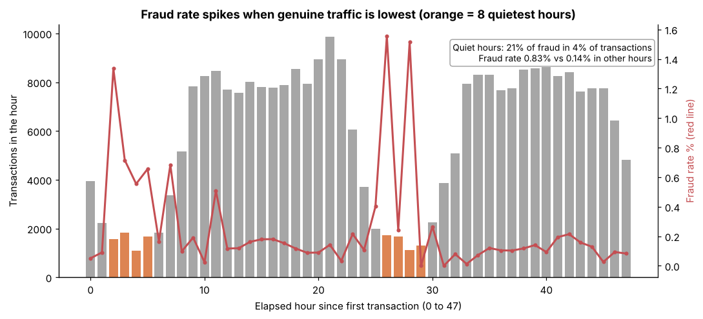
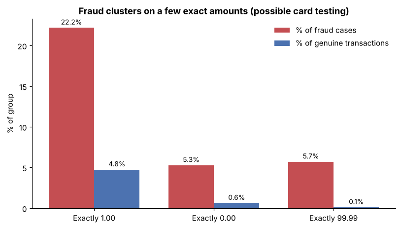
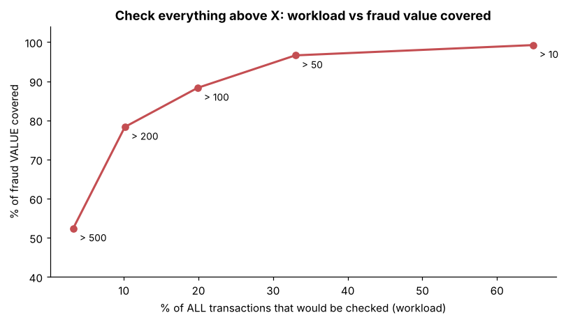
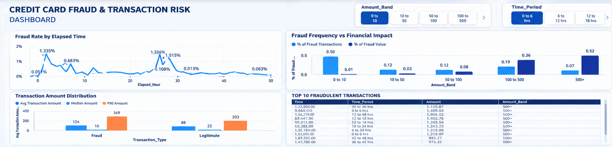

# Credit Card Fraud & Transaction Risk Analysis

**Fraud frequency, financial impact and a risk-monitoring dashboard** | Python • SQL • Power BI • DAX


[](Images/dashboard_page1.png)

| 283,726 | 473 | 0.167% | 0.233% | 52.4% |
|:---:|:---:|:---:|:---:|:---:|
| **transactions analysed** | **fraud cases** | **fraud rate** | **fraud value rate** | **of fraud money sits in the "500+" band** |

---

## Contents
1. [The project in 30 seconds](#1-the-project-in-30-seconds)
2. [About the project and business context](#2-about-the-project-and-business-context)
3. [Business problem and objectives](#3-business-problem-and-objectives)
4. [Stakeholders](#4-stakeholders)
5. [Dataset and data dictionary](#5-dataset-and-data-dictionary)
6. [Tools used](#6-tools-used)
7. [Analysis workflow](#7-analysis-workflow)
8. [KPIs](#8-kpis)
9. [Key findings](#9-key-findings)
10. [SQL analysis](#10-sql-analysis)
11. [Statistical checks](#11-statistical-checks)
12. [Power BI dashboard](#12-power-bi-dashboard)
13. [Business recommendations](#13-business-recommendations)
14. [Business impact](#14-business-impact)
15. [Business Analyst documents](#15-business-analyst-documents)
16. [Limitations](#16-limitations)
17. [Future scope](#17-future-scope)
18. [Project structure](#18-project-structure)
19. [How to reproduce](#19-how-to-reproduce)
20. [Conclusion](#20-conclusion)

---

## 1. The project in 30 seconds

> Fraud is very rare, about **1 in 600** card transactions, so it is easy to miss in normal reports. In this data, **small transactions create most fraud cases but almost no fraud money**, while **transactions above 500 hold over half of the fraud value**. So frequency and money tell different stories.
>
> **Two more findings:** fraud keeps arriving when genuine traffic drops (the 8 quietest hours hold **21% of fraud in 4% of transactions**), and about **1 in 5 frauds is exactly 1.00**, a possible card-testing pattern.
>
> **Advice:** a risk-ranked review for large amounts, step-up checks in the middle range, and automated rules for small repeated amounts, with a weekly KPI dashboard.

---

## 2. About the project and business context

A **card issuer** (a bank or card company) loses money and customer trust when fraudulent transactions are approved. This project analyses **283,726 credit card transactions** to answer three business questions:

1. **How often** does fraud happen? (frequency)
2. **How much money** is involved? (financial impact)
3. **Where** is the risk concentrated? (transaction size and time window)

It is a **descriptive risk-analytics project**: data cleaning, EDA, KPIs, SQL, statistical checks, a Power BI dashboard and recommendations. It is **not** a machine-learning model, and the reason is explained in [Limitations](#16-limitations).

**Words you will see**

| Word | Plain meaning |
|---|---|
| **Fraud rate** | Of every 100 transactions, how many are fraud (0.167 per 100) |
| **Fraud value rate** | Of every 100 currency units spent, how much is fraud (0.233 per 100) |
| **Accuracy trap** | Saying "everything is legitimate" is 99.83% accurate yet catches no fraud |
| **False positive** | A genuine transaction wrongly flagged, which annoys the customer and costs review time |
| **Step-up authentication** | An extra check (for example a one-time password) for risky transactions instead of blocking them |
| **Velocity rule** | An automatic rule such as many small payments on one card in a short time |
| **Card testing** | A fraudster makes a tiny charge (often 1.00) to check a stolen card works |
| **PCA features (V1-V28)** | Anonymised numbers with no business meaning |

More domain notes: [`Documentation/BA_Documents/01_business_context_and_domain.md`](Documentation/BA_Documents/01_business_context_and_domain.md)

---

## 3. Business problem and objectives

A card issuer cannot tell where its fraud risk sits if it only looks at totals. Fraud is rare, and an approach that treats every transaction as suspicious would annoy genuine customers.

| # | Objective | Result |
|---|---|---|
| 1 | Measure fraud frequency and financial impact | Fraud rate **0.167%**; fraud value rate **0.233%** |
| 2 | Compare fraud and legitimate amounts | Median fraud **9.82** vs **22.00**; average fraud **123.87** vs **88.41** |
| 3 | Find where fraud cases and fraud money are concentrated | "0 to 10": 50.3% of cases, 0.8% of value. "500+": 7.2% of cases, 52.4% of value |
| 4 | Check whether fraud rate changes over the data window | 0.076% to 0.520% across 6-hour elapsed periods; 0.83% in the 8 quietest hours vs 0.14% elsewhere |
| 5 | Find anonymised features statistically linked to fraud | V17, V14, V12 strongest |
| 6 | Define monitoring KPIs and recommendations | 5 dashboard KPI cards (10 KPIs calculated in Python), 7 recommendations |

---

## 4. Stakeholders

| Stakeholder | What they need from this analysis |
|---|---|
| **Fraud Operations Manager** | How big the alert queue would be, and how to use analyst time |
| **Head of Risk** | Where the fraud money sits |
| **Card Product Manager** | How much customer friction each control creates |
| **Senior Management** | Overall exposure on one page |
| **Risk Analytics team** | Data quality, limits and what data to capture next |

Full stakeholder matrix: [`Documentation/BA_Documents/04_risk_register_and_stakeholder_matrix.md`](Documentation/BA_Documents/04_risk_register_and_stakeholder_matrix.md)

---

## 5. Dataset and data dictionary

- **Source:** Credit Card Fraud Detection, ULB Machine Learning Group (Kaggle). European cardholders, September 2013, about 48 hours of transactions. See the Kaggle page for licence terms.
- **Size:** 284,807 rows × 31 columns, 492 fraud cases (0.172%).
- **After cleaning:** 283,726 rows, **473 fraud** (0.167%). 1,081 exact duplicate rows were removed (19 were fraud).
- **Target:** `Class` (0 = legitimate, 1 = fraud).

| Column | Meaning |
|---|---|
| `Time` | Seconds elapsed since the first transaction. **Elapsed time, not clock time.** |
| `V1`-`V28` | Anonymised **PCA-transformed** features. **No business meaning.** |
| `Amount` | Transaction amount (currency not stated) |
| `Class` | 0 = legitimate, 1 = fraud |

**Columns created in Python**

| Column | How it is made | Why |
|---|---|---|
| `Transaction_Type` | "Fraud" or "Legitimate" from `Class` | Readable labels |
| `Time_Hours` | `Time` / 3600 | Easier to read |
| `Time_Period` | Eight 6-hour **elapsed** bins | Fraud rate over the window |
| `Elapsed_Hour` | Whole elapsed hours | Hourly view |
| `Amount_Band` | 0 to 10, 10 to 50, 50 to 100, 100 to 500, 500+ | Where cases and money sit |

**Data quality**

| Check | Result |
|---|---|
| Missing values | 0 |
| Exact duplicate rows | 1,081 removed (19 were fraud) |
| Invalid values | 0 |
| Zero amounts | Kept |

The raw `creditcard.csv` (about 144 MB) is not stored here. Download it from Kaggle (see `Data/README.md`).

---

## 6. Tools used

| Area | Tools | Used for |
|---|---|---|
| **Python** (Google Colab) | Pandas, NumPy, Matplotlib, Seaborn, SciPy | Cleaning, EDA, KPIs, statistical checks |
| **SQL** (MySQL 8) | CTEs, window functions, `RANK`, `LAG`, running totals, median | 9 queries that cross-check the Python and Power BI numbers (tested on the real data) |
| **Power BI and DAX** | KPI cards, slicers, 3-page interactive dashboard | Risk-monitoring dashboard |
| **Documentation** | Markdown, Word and PDF report, Git and GitHub | BA documents and the project report |

---

## 7. Analysis workflow

```
 Kaggle creditcard.csv
         |
         v
 PYTHON (Colab) ... quality checks, duplicate removal, new columns, EDA, 10 KPIs, exports
         |
         v
 SQL ............... same questions in SQL to cross-check the numbers
         |
         v
 POWER BI + DAX .... dashboard, measures validated against Python
         |
         v
 Insights, recommendations, BA documents
```

**Python** (`Python/Credit_Card_Fraud_Risk_Analytics.ipynb`)

1. Loaded the data and checked shape, types and statistics.
2. Data-quality check: missing values (0), duplicates (1,081), invalid values (0), zero amounts (kept).
3. Created `Transaction_Type`, `Time_Hours`, `Time_Period`, `Elapsed_Hour` and `Amount_Band`.
4. EDA: fraud distribution, amount comparison (median and log scale because amounts are skewed), fraud rate by band and period, fraud concentration, top frauds, V-feature correlation.
5. Calculated 10 KPIs, wrote data-driven insights and recommendations, exported CSVs.

**Power BI** (`PowerBI/`): DAX measures validated against Python (283,726 transactions, 473 fraud, 58,591.39 fraud value).

---

## 8. KPIs

| KPI | Formula | Value |
|---|---|---|
| Total Transactions | count of rows | 283,726 |
| Fraud Transactions | count where Class = 1 | 473 |
| Legitimate Transactions | count where Class = 0 | 283,253 |
| **Fraud Rate %** | Fraud ÷ Total × 100 | **0.167%** |
| Total Transaction Value | sum of Amount | 25,102,001.68 |
| Fraud Transaction Value | sum of Amount where Class = 1 | 58,591.39 |
| **Fraud Value Rate %** | Fraud Value ÷ Total Value × 100 | **0.233%** |
| Average Transaction Amount | Total Value ÷ Total Transactions | 88.47 |
| Average Fraud Amount | Fraud Value ÷ Fraud Transactions | 123.87 |
| Maximum Fraud Amount | max Amount where Class = 1 | 2,125.87 |

These are the 10 KPIs in `Data/fraud_kpi_summary.csv`. Extra statistics used in the analysis: median fraud amount 9.82 vs 22.00 for legitimate.

**Keep these four separate:** transaction count (how many) · fraud rate (how often) · fraud amount (how much money) · fraud value rate (fraud money as a share of all money).

---

## 9. Key findings

| # | Finding | Evidence |
|---|---|---|
| 1 | Fraud is rare | 473 of 283,726 = 0.167% (about 1 in 600) |
| 2 | Accuracy is a misleading KPI | "Everything is legitimate" would be 99.83% right and catch 0 frauds |
| 3 | Fraud hurts more by value than by count | Fraud value rate 0.233% vs fraud rate 0.167% |
| 4 | Typical fraud is small; a few large cases lift the average | Median 9.82 vs 22.00; average 123.87 vs 88.41 |
| 5 | Small transactions: many cases, little money | "0 to 10": 50.3% of fraud cases, 0.8% of fraud value |
| 6 | Large transactions: highest rate and most money | "500+": 3.2% of transactions, fraud rate 0.373% (2.2× average), 52.4% of fraud value |
| 7 | Bands above 100 carry most of the loss | 88.3% of fraud value from 26.4% of fraud cases |
| 8 | Fraud rate varies by elapsed period | 0.076% (30 to 36 hrs) to 0.520% (24 to 30 hrs). The two highest-rate periods are also the quietest (about 12,000 vs 35,000 average transactions) |
| 9 | A few large frauds matter | Largest 2,125.87; 34 frauds above 500; top 5 = 14.1% of fraud value |
| 10 | Statistical signals exist | V17 (−0.313), V14 (−0.293), V12 (−0.251). Anonymised, so no business meaning |
| 11 | **Fraud keeps arriving when genuine traffic drops** | The 8 quietest elapsed hours (2-5 and 26-29, exactly 24 hours apart, picked by volume alone) hold **20.9% of fraud in 4.2% of transactions**: fraud rate **0.83% vs 0.14%** (6×). Hourly fraud *count* does not follow traffic (Spearman 0.17, p = 0.26) but the *rate* does (−0.33, p = 0.02) |
| 12 | **Many frauds are tiny and repeat exact amounts** | 22.2% of fraud cases are exactly **1.00** (4.8% of genuine transactions); 5.3% are exactly 0.00; 36% of fraud cases are 1.00 or less but hold only 0.2% of fraud value. Fits **card testing**; cannot be confirmed without a card ID |

> **Why findings 8 and 11 need care:** a period with fewer genuine transactions can show a higher fraud rate even if fraud cases stay similar. That is partly a denominator effect, so volume must be read next to the rate. Finding 11 tests it: fraud does not drop when traffic drops, so the rate really does rise. `Time` is elapsed time, so there is **no claim about night or day**; real timestamps are needed.





---

## 10. SQL analysis

Files: [`SQL/00_create_and_load.sql`](SQL/00_create_and_load.sql) (creates the table and loads the cleaned CSV; run first) and [`SQL/fraud_risk_analysis.sql`](SQL/fraud_risk_analysis.sql) (9 queries, MySQL 8). It answers the same business questions as Python and Power BI so the numbers can be cross-checked. **Tested on the real data: every query matches Python and Power BI.** Saved outputs are in `Data/sql_results/`.

| # | Business question | SQL skill shown |
|---|---|---|
| Q1 | How often is there fraud and how much money? | Aggregates, `CASE` |
| Q2 | Which amount bands hold the most fraud cases and fraud money? | CTE, `SUM() OVER ()` |
| Q3 | How fast does fraud value build up across bands? | Running total |
| Q4 | Does fraud rate change across elapsed periods? | `RANK`, `LAG` |
| Q5 | Is the typical fraud small (median)? | `ROW_NUMBER`, `COUNT() OVER`, median |
| Q6 | If we check everything above X, what is the workload and what is covered? | Threshold table, `CROSS JOIN` |
| Q7 | How concentrated are the biggest frauds? | `ROW_NUMBER` |
| Q8 | Does fraud keep coming when genuine traffic drops? | `RANK`, `SUM(SUM()) OVER` |
| Q9 | Do frauds cluster on exact amounts like 1.00? | `CASE`, subquery shares |

**Example: fraud cases vs fraud money by amount band**

```sql
WITH band AS (
    SELECT amount_band,
           COUNT(*)                                           AS transactions,
           SUM(is_fraud)                                      AS fraud_cases,
           SUM(CASE WHEN is_fraud = 1 THEN amount ELSE 0 END) AS fraud_value
    FROM v_tx
    GROUP BY amount_band
)
SELECT amount_band, transactions, fraud_cases,
       ROUND(100.0 * fraud_cases / transactions, 3)             AS fraud_rate_pct,
       ROUND(100.0 * fraud_cases / SUM(fraud_cases) OVER (), 1) AS pct_of_fraud_cases,
       ROUND(100.0 * fraud_value / SUM(fraud_value) OVER (), 1) AS pct_of_fraud_value
FROM band
ORDER BY amount_band;
```

---

## 11. Statistical checks

Script: [`Python/02_statistical_and_threshold_analysis.py`](Python/02_statistical_and_threshold_analysis.py). Run on the real data; output is in `Data/stat_results/`.

| Question | Method | Result | What it tells us |
|---|---|---|---|
| How sure are we about the fraud rate? | 95% Wilson interval | 0.167% (0.152% to 0.182%) | Narrow, because there are 283,726 transactions |
| Do rates differ by amount band? | Chi-square, Cramér's V | χ² = 117.6, p < 0.001, V = 0.020 | The difference is real. V is small because fraud is so rare, so amount alone is a weak predictor |
| Is "500+" riskier than everything else? | 2×2 chi-square, intervals | 0.373% (0.267% to 0.521%) vs 0.160% (0.146% to 0.176%), 2.3×, p < 0.001 | Yes, not luck |
| Do rates differ by time period? | Chi-square | χ² = 201.9, p < 0.001, V = 0.027 | Real, but each period has only 27 to 91 frauds, so intervals are wide |
| Are the quiet hours riskier? | 2×2 chi-square | 0.826% vs 0.138%, 6.0×, p < 0.001 | Yes. 8 hours picked by volume, not by fraud |
| Are fraud amounts different from genuine ones? | Mann-Whitney U | p < 0.001; a random fraud is larger than a random genuine transaction only 44.4% of the time | Typical fraud is *smaller*; the higher average comes from a few big cases |
| What does "check everything above X" cost? | Threshold table | Above 500: 3.2% of transactions checked, 52.4% of fraud value covered, 268 checks per fraud | See chart 12 |



Why these tests: chi-square compares categories (band vs fraud); Mann-Whitney is used because amounts are very skewed and a mean-based test would mislead; confidence intervals show how sure each rate is (few cases = wide range).

---

## 12. Power BI dashboard

**Page 1: Overview**

[](Images/dashboard_page1.png)

**Page 2: Fraud Analysis**

[](Images/dashboard_page2.png)

File: `PowerBI/Credit_Card_Fraud_Risk_Dashboard.pbix` (open in Power BI Desktop; GitHub cannot preview it).

| Page | Contents |
|---|---|
| **1. Overview** | 5 KPI cards (Total Transactions, Fraud Transactions, Fraud Rate %, Fraud Transaction Value, Fraud Value Rate %), Fraud vs Legitimate donut, Fraud Rate by Transaction Amount, Fraud Frequency vs Financial Impact, Fraud Rate by Elapsed Time, Transaction Amount Distribution (average, median, P90) |
| **2. Fraud Analysis** | Fraud Rate by Elapsed Time, Fraud Frequency vs Financial Impact, Transaction Amount Distribution (average, median, P90), Top 10 Fraudulent Transactions |
| **3. Insights & Risk Recommendations** | Key findings and 5 headline recommendations as text |
| **Slicers** (pages 1 and 2) | `Amount_Band` and `Time_Period` |

> **Reading the charts:** `Elapsed_Hour` is hours since the first transaction, not clock time. Fraud rate is shown per hour, so hours with few transactions can show spikes.

**Design choice:** there is no Transaction_Type slicer, because choosing "Fraud" would force the fraud rate to 100%.

**Validation:** the DAX results match Python and SQL exactly: 283,726 transactions, 473 fraud, 58,591.39 fraud value, 0.167% and 0.233%. DAX is in [`PowerBI/DAX_Measures.md`](PowerBI/DAX_Measures.md).

---

## 13. Business recommendations

The dashboard's page 3 shows the 5 headline recommendations; the full list of 7 is below. These are suggestions based on observed patterns. They are **not guaranteed** to reduce fraud and should be piloted or back-tested first.

| # | Recommendation | Based on | Owner | Success measure |
|---|---|---|---|---|
| 1 | Risk-ranked priority queue for transactions above 500 (automated checks first, manual review for the riskiest) | Findings 6, 9 | Fraud Operations Manager | % of fraud value caught; review time |
| 2 | Step-up authentication for transactions above 100 instead of blocking | Finding 7 | Card Product Manager with Head of Risk | Fraud value rate; customer drop-off |
| 3 | Automated velocity rules for small repeated amounts (for example many 1.00 charges on one card), not manual review | Findings 5, 12 | Fraud Operations Manager | Fraud count in small bands; alert volume |
| 4 | Monitor fraud rate by time window and apply stricter checks in low-traffic windows; confirm with real timestamps first | Findings 8, 11 | Risk Analytics team | Rate vs threshold |
| 5 | Test anomaly rules on the real attributes behind the strongest signals | Finding 10 | Risk Analytics team | Share of alerts that are truly fraud |
| 6 | Weekly KPI dashboard: fraud rate, fraud value rate, concentration | Findings 1-3 | Risk Analytics team | Dashboard refreshed on schedule |
| 7 | Capture merchant, location, channel, real timestamp and unique transaction ID | Limitations | Data / IT team | Data completeness |

---

## 14. Business impact

| Area | Impact |
|---|---|
| **Better KPIs** | Fraud rate, fraud value rate and concentration give a clearer risk view than totals or accuracy |
| **Review policy** | Shows that small transactions create most cases but almost no money, while the "500+" band holds 52.4% of fraud value |
| **Customer experience** | Steers the team towards step-up checks rather than blocking or reviewing everything |
| **Data priorities** | Lists the data to capture so the next analysis can explain who, where and when |

**Size of the opportunity (illustrative, not a forecast).** The "500+" band holds **30,682.65** (52.4%) of fraud value, but 99.6% of its 9,109 transactions are genuine (about **1 fraud per 268** transactions). Blanket review would mean 9,109 checks to find 34 frauds, so the queue must be risk-ranked with step-up checks. If a risk-ranked process stopped 20%, 40% or 60% of that band's fraud value, it would protect about **6,137, 12,273 or 18,410** over the two-day window. The catch rates are assumptions and no cost data exists. Details: [`Documentation/BA_Documents/05_business_impact_scenario.md`](Documentation/BA_Documents/05_business_impact_scenario.md)

---

## 15. Business Analyst documents

| Document | What it covers |
|---|---|
| [`01_business_context_and_domain.md`](Documentation/BA_Documents/01_business_context_and_domain.md) | Business context, glossary, KPI formulas, objectives, stakeholders |
| [`02_BRD_lite_and_user_stories.md`](Documentation/BA_Documents/02_BRD_lite_and_user_stories.md) | Business and functional requirements, user stories, acceptance criteria |
| [`03_process_as_is_to_be.md`](Documentation/BA_Documents/03_process_as_is_to_be.md) | As-Is and To-Be process flows |
| [`04_risk_register_and_stakeholder_matrix.md`](Documentation/BA_Documents/04_risk_register_and_stakeholder_matrix.md) | Risks with mitigation, stakeholder matrix, recommendation owners |
| [`05_business_impact_scenario.md`](Documentation/BA_Documents/05_business_impact_scenario.md) | Illustrative impact scenario with assumptions |
| [`06_interview_prep_and_resume.md`](Documentation/BA_Documents/06_interview_prep_and_resume.md) | Project pitch, interview Q&A, resume bullets |

The full project report is in [`Documentation/Credit_Card_Fraud_Project_Report.pdf`](Documentation/Credit_Card_Fraud_Project_Report.pdf).

---

## 16. Limitations

- V1-V28 are anonymised PCA variables, so the analysis identifies **statistical patterns** rather than directly interpretable business attributes.
- `Time` is elapsed time, so no claims such as "fraud happens at night" are made.
- Only about 2 days of data and 473 fraud cases; no merchant, customer or location data.
- Per-period fraud rates rest on few cases each, so treat them with caution.
- The quiet-hours and exact-amount findings are **patterns**, not proof. There is no card ID (so card testing cannot be confirmed) and no clock time (so the quiet window cannot be called night).
- The project is **descriptive**, not predictive. A model on anonymised features would not give business-readable rules, and the goal was a monitoring view for a risk team.
- Amount currency is not stated, and there is no cost, chargeback or customer-friction data, so no ROI is calculated.

---

## 17. Future scope

- Add **real timestamps, merchant, location, channel and a unique transaction ID**, then explore velocity rules and time-of-day patterns.
- Build a **baseline classification model** judged on precision-recall (not accuracy) to compare with the simple threshold rules.
- Add **cost data** (review cost, chargebacks, customer drop-off) to calculate a real return on investment.
- Move to **scheduled refresh** and alerting in Power BI.

---

## 18. Project structure

```
Card-Fraud-Risk-Analysis/
│
├── README.md
├── requirements.txt
├── .gitignore
│
├── Data/
│   ├── fraud_cleaned.csv                (283,726 rows, Power BI ready)
│   ├── fraud_kpi_summary.csv
│   ├── fraud_by_amount_band.csv
│   ├── fraud_by_time_period.csv
│   ├── fraud_by_elapsed_hour.csv
│   ├── fraud_by_transaction_type.csv
│   ├── fraud_feature_summary.csv
│   ├── top_fraud_transactions.csv
│   ├── stat_results/                    (output of the statistical script)
│   ├── sql_results/                     (saved output of the 9 SQL queries)
│   └── README.md                        (how to get the raw Kaggle file)
│
├── Python/
│   ├── Credit_Card_Fraud_Risk_Analytics.ipynb
│   └── 02_statistical_and_threshold_analysis.py
│
├── SQL/
│   ├── 00_create_and_load.sql           (run first)
│   └── fraud_risk_analysis.sql          (9 queries)
│
├── PowerBI/
│   ├── Credit_Card_Fraud_Risk_Dashboard.pbix
│   ├── DAX_Measures.md
│   └── README.md
│
├── Documentation/
│   ├── Credit_Card_Fraud_Project_Report.docx
│   ├── Credit_Card_Fraud_Project_Report.pdf
│   └── BA_Documents/                    (BRD, user stories, process flow, risks, interview prep)
│
└── Images/                              (dashboard screenshots + charts 01-12)
```

---

## 19. How to reproduce

1. Download `creditcard.csv` from Kaggle (see `Data/README.md`).
2. Open `Python/Credit_Card_Fraud_Risk_Analytics.ipynb` in Google Colab, run all cells and upload the file when asked. A ZIP of the CSV outputs is downloaded.
3. Install the packages for the extra script: `pip install -r requirements.txt`, then run `python Python/02_statistical_and_threshold_analysis.py` from the repo root.
4. *(SQL)* In MySQL, edit the file path in `SQL/00_create_and_load.sql` and run it (expect 283,726 rows and 473 fraud). Then run `SQL/fraud_risk_analysis.sql` one query at a time.
5. *(Power BI)* Load `fraud_cleaned.csv`, create the measures in `PowerBI/DAX_Measures.md`, and check the cards against the validation table.

---

## 20. Conclusion

This project shows how analytics supports fraud-risk decisions even when fraud is very rare. The key lesson is that **fraud frequency and fraud money tell different stories**: small transactions create most fraud cases, while large transactions hold most of the fraud value. Two more patterns support the same message: fraud does not slow down when genuine traffic does, and many frauds are tiny, repeated amounts. A dashboard built on fraud rate, fraud value rate and concentration gives a risk team a more useful view than total volumes or accuracy.
